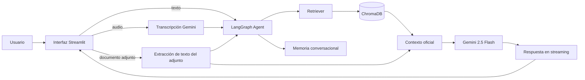

# 🤖 Asistente Inteligente de Extranjería para Autorizaciones de Residencia y Trabajo mediante Gemini, RAG y LangGraph


---

# 1. 📌 Descripción del proyecto

Este proyecto desarrolla un **asistente conversacional especializado en procedimientos de extranjería para Autorizaciones de Residencia y Trabajo en España**, capaz de responder preguntas utilizando exclusivamente la información contenida en documentación oficial.

El sistema implementa una arquitectura **Retrieval-Augmented Generation (RAG)** que combina recuperación semántica de documentos con un modelo de lenguaje de Google Gemini para proporcionar respuestas fundamentadas y reducir las alucinaciones propias de los LLM.

El asistente está especializado en dos procedimientos administrativos:

* **Hoja Informativa nº12** — Autorización inicial de residencia temporal y trabajo por cuenta ajena.
* **Hoja Informativa nº55** — Modificación desde autorizaciones de residencia temporal por circunstancias excepcionales a residencia y trabajo.

## Dominio de aplicación

El dominio está caracterizado por una gran cantidad de normativa y documentación administrativa centrada en el ámbito de la extranjería donde los usuarios suelen plantear consultas sobre requisitos, documentación necesaria, plazos o procedimientos, cuya respuesta debe basarse en fuentes oficiales y actualizadas.

Este tipo de información es especialmente adecuado para una arquitectura Retrieval-Augmented Generation (RAG), ya que las respuestas deben fundamentarse en documentos concretos y no en el conocimiento general del modelo.

El proyecto integra además **memoria conversacional** mediante LangGraph, permitiendo mantener el contexto entre preguntas consecutivas.

El asistente cuenta con una **interfaz web construida con Streamlit** que va más allá de un simple chat de texto: permite adjuntar documentos propios como contexto puntual de la conversación y realizar preguntas por voz, mostrando las respuestas con efecto de escritura en tiempo real.

---

# 2. 🎯 Objetivos

El proyecto persigue los siguientes objetivos:

* Generar respuestas precisas y fundamentadas.
* Mantener el contexto de la conversación mediante memoria.
* Implementar un flujo de agente utilizando LangGraph.
* Facilitar la consulta de procedimientos administrativos de forma sencilla.

## System Prompt Design

El system prompt define el comportamiento del asistente para garantizar respuestas fiables y alineadas con el objetivo del proyecto.

Se diseñó con los siguientes criterios:

- Responder únicamente utilizando documentación oficial recuperada mediante RAG;
- No inventar información cuando el contexto no contenga la respuesta;
- Indicar cuando la documentación disponible es insuficiente;
- Mantener un tono claro, profesional y orientado al usuario;
- Evitar interpretaciones legales o recomendaciones que no aparezcan en la documentación oficial.

Este enfoque reduce las alucinaciones del modelo y mejora la confianza en las respuestas generadas.

---

# 3. 📂 Base documental

El conocimiento del asistente proviene exclusivamente de documentación oficial del Gobierno de España.

Los documentos utilizados son:

* **Hoja Informativa nº12**

  * Autorización inicial de residencia temporal y trabajo por cuenta ajena.

* **Hoja Informativa nº55**

  * Modificación de autorizaciones por circunstancias excepcionales a residencia y trabajo.

Estos documentos son indexados para construir la base vectorial utilizada durante la recuperación de contexto.

---

# 4. 💬 Casos de uso

El asistente puede responder preguntas como:

* ¿Qué requisitos debo cumplir?
* ¿Qué documentación necesito?
* ¿Quién presenta la solicitud?
* ¿Cuánto tarda la resolución?
* ¿Qué tasas debo pagar?
* ¿Qué ocurre si me deniegan la autorización?
* ¿Cuándo puedo modificar mi autorización?
* ¿Qué diferencias existen entre ambos procedimientos?

Todas las respuestas se generan exclusivamente a partir de la documentación indexada.

---

# 5. 💻 Interfaz Streamlit

Además del notebook, el proyecto incluye una **aplicación web (`app.py`)** construida con Streamlit que expone el asistente como un chat completo, pensado para que la experiencia no se quede en una caja de texto simple:

* **💬 Respuesta en streaming** — las respuestas del modelo se escriben token a token en tiempo real, con el efecto de "máquina de escribir" habitual en los asistentes conversacionales modernos.
* **📎 Adjuntar documentos** — el usuario puede subir un PDF, Word o TXT propio (por ejemplo, una carta de la Oficina de Extranjería) para que el asistente lo tenga en cuenta al responder. Este documento **se usa únicamente como contexto de esa conversación** y en ningún caso se indexa en la base vectorial oficial; el asistente siempre distingue en su respuesta si la información procede de la documentación oficial o del documento adjuntado por el usuario.
* **🎙️ Preguntas por voz** — es posible formular la pregunta hablando, ya sea grabando el audio en directo desde el micrófono del navegador o subiendo un archivo de audio ya grabado (wav, mp3, m4a, ogg). El audio se transcribe automáticamente a texto con Gemini antes de pasar por el flujo de RAG.
* **🧵 Memoria por conversación** — cada sesión del navegador mantiene su propio `thread_id`, gestionado por el checkpointer de LangGraph, y puede reiniciarse en cualquier momento con el botón "Nueva conversación".

Ejecución:

```bash
streamlit run app.py
```

---

# 6. 🏗️ Arquitectura del sistema

El flujo general del sistema es el siguiente:




---

# 7. 📄 Procesamiento de documentos

Para preparar la información utilizada por el asistente se realiza el siguiente pipeline:

1. Carga de documentos PDF.
2. Extracción del texto.
3. División del contenido en *chunks*.
4. Generación de embeddings mediante Gemini.
5. Almacenamiento de embeddings en ChromaDB.
6. Recuperación semántica mediante búsqueda vectorial.

Este proceso permite recuperar únicamente los fragmentos relevantes para cada consulta realizada por el usuario.

---

# 8. 🧠 Generación de respuestas (RAG)

Cuando el usuario realiza una consulta:

1. Se transforma la pregunta en un embedding.
2. Se buscan los fragmentos más similares en ChromaDB.
3. Los documentos recuperados se incorporan al prompt.
4. Gemini genera la respuesta utilizando únicamente ese contexto.
5. La conversación queda almacenada en memoria para futuras interacciones.

Este enfoque mejora significativamente la precisión respecto a un modelo generativo sin recuperación de información.

## 💬 Ejemplo:

**Usuario**

> ¿Cuál es el plazo de resolución?

**Asistente**

El plazo de resolución de la solicitud es de tres meses, contados a partir del día siguiente a la fecha en que haya tenido entrada en el registro del órgano competente para su tramitación.

---

# 9. 💾 Memoria conversacional

El asistente utiliza memoria mediante LangGraph para:

* Recordar preguntas anteriores;
* Mantener el contexto entre interacciones;
* Responder preguntas de seguimiento;
* Ofrecer una conversación más natural.

De esta forma el usuario no necesita repetir continuamente la información ya proporcionada.

---

# 10. 🚀 Resultados

El proyecto demuestra la integración de las principales tecnologías actuales para el desarrollo de asistentes inteligentes:

* Large Language Models (LLM)
* Retrieval-Augmented Generation (RAG)
* Embeddings
* Bases vectoriales
* Recuperación semántica
* Agentes con LangGraph
* Memoria conversacional
* Interfaz conversacional multimodal (texto y voz) con Streamlit

El resultado es un asistente capaz de proporcionar respuestas contextualizadas, fundamentadas y alineadas con documentación oficial.

---

# 11. 📈 Posibles mejoras

Algunas líneas futuras de desarrollo incluyen:

* Incorporar más procedimientos administrativos.
* Añadir citación automática del documento y página de origen.
* Implementar búsqueda híbrida (vectorial + BM25).
* Interpretar imágenes adjuntadas (por ejemplo, fotos de formularios) con Gemini Vision.
* Incorporar evaluación automática mediante RAGAS.
* Gestionar historiales persistentes de usuarios (más allá de la sesión del navegador).
* Añadir autenticación y control de acceso.
* Desplegar la aplicación Streamlit en Streamlit Community Cloud o similar.

---

# 📁 Estructura del proyecto

```
Proyecto_Extranjeria_RAG/

├── data/
│   ├── hoja12.pdf
│   └── hoja55.pdf
│
├── chroma_db/
│
├── notebooks/
│   └── Asistente_Extranjeria.ipynb
│
├── src/
│   ├── __init__.py
│   ├── config.py            # claves, modelos y parámetros del proyecto
│   ├── document_loader.py   # carga de los PDF oficiales
│   ├── embeddings.py        # modelo de embeddings de Gemini
│   ├── vectorstore.py       # construcción / carga de ChromaDB
│   ├── retriever.py         # retriever semántico
│   ├── prompts.py           # system prompt y plantilla RAG
│   ├── graph.py             # agente LangGraph (retrieve → generate → memory)
│   ├── attachments.py       # extracción de texto de adjuntos puntuales
│   ├── audio.py             # transcripción de audio con Gemini
│   └── memory.py            # gestión del thread_id de conversación
│
├── app.py                   # aplicación Streamlit
├── .env.example
├── README.md
└── requirements.txt
```

---

# 🛠️ Tecnologías

| Layer        | Technology        |
| ------------ | ----------------- |
| LLM          | Gemini 2.5 Flash  |
| Framework    | LangChain         |
| Agente        | LangGraph         |
| Embeddings   | Google Generative AI Embeddings |
| Vector Store | ChromaDB          |
| Interfaz     | Streamlit         |
| Transcripción de audio | Google Gemini (SDK `google-genai`) |
| Adjuntos     | pypdf / python-docx |
| Lenguaje de Programación | Python 3.12.10 |

---

# Instalación

Clonar el repositorio

```bash
git clone https://github.com/usuario/Asistente-Extranjeria.git
cd Asistente-Extranjeria
```

Crear un entorno virtual

```bash
python -m venv .venv
```

Activarlo

Windows

```bash
.venv\Scripts\activate
```

Linux/macOS

```bash
source .venv/bin/activate
```

Instalar dependencias

```bash
pip install -r requirements.txt
```

---

## Configurar Gemini API

Crear una variable de entorno llamada:

```text
GOOGLE_API_KEY=YOUR_API_KEY
```

O copiar `.env.example` a `.env` y sustituir el valor:

```bash
cp .env.example .env
```

```text
GOOGLE_API_KEY=YOUR_API_KEY
```

Tanto el notebook como la aplicación Streamlit usarán automáticamente esta llave para la autenticación con Google Gemini.

---

## Ejecución

### Opción 1 · Aplicación web (Streamlit)

```bash
streamlit run app.py
```

La primera vez que se ejecuta, si no existe todavía `chroma_db/`, la aplicación construye la base vectorial a partir de los PDF de `data/` (puede tardar unos segundos).

### Opción 2 · Notebook

Lanzar Jupyter Notebook:

```bash
jupyter notebook
```

Abrir:

```
notebooks/Asistente_Extranjeria.ipynb
```

Ejecutar las celdas en orden.

---

# ⭐ Key Takeaway

Los modelos de lenguaje alcanzan su máximo potencial cuando se combinan con sistemas de recuperación de información. Mediante una arquitectura RAG basada en documentación oficial, es posible construir asistentes especializados que proporcionen respuestas precisas, contextualizadas y significativamente más fiables que un LLM utilizado de forma aislada.

---

# 👨‍💻 Autor

Proyecto desarrollado como caso práctico de **Large Language Models (LLM)**, **Retrieval-Augmented Generation (RAG)** y **LangGraph**, enfocado en el desarrollo de un asistente inteligente para la consulta de procedimientos oficiales de extranjería en España.
